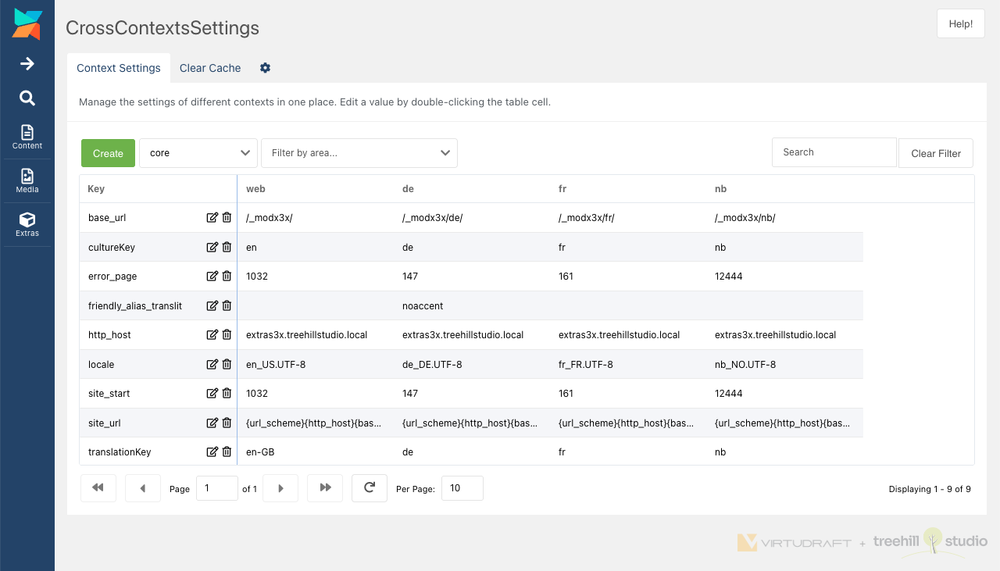
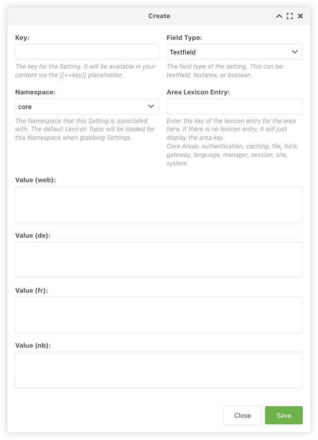
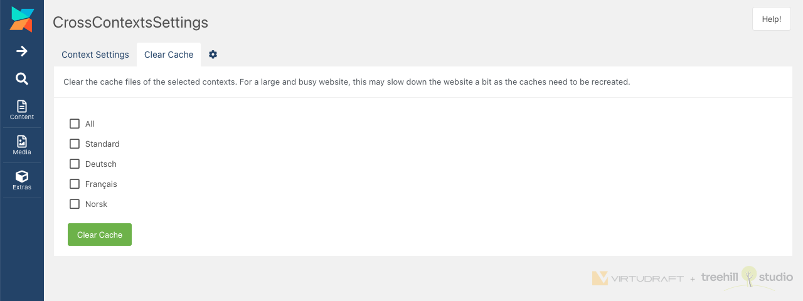
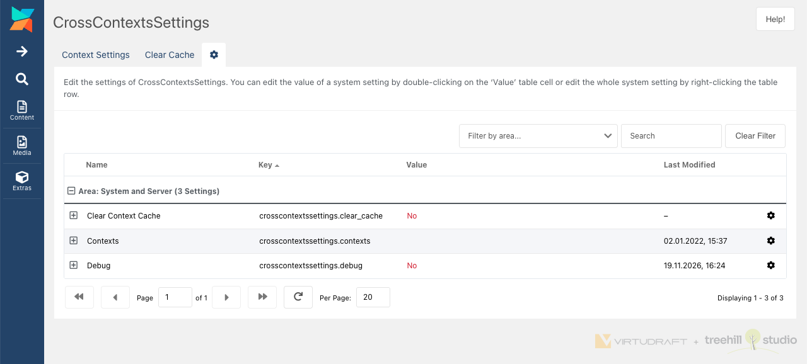

## Custom Manager Page

To use the component, navigate to your manager and click on "Extras > CrossContextsSettings".

The contexts settings grid shows each setting key in one row and the value of
that setting in each context in one column. The `mgr` context is never shown.
The displayed contexts can be restricted with the system setting
`crosscontextssettings.contexts`.

You can create a new context setting in several contexts with a click on the
Create button on the top left above the contexts settings grid.

The grid can be filtered by the namespace, the area and with a search input on
the top right above the contexts settings grid. The namespace filter starts with
the `core` namespace (or with the namespace in the `ns` URL parameter). The
search by key looks in all namespaces and areas and resets the namespace and
area filters.

Each context setting can be edited inline with a double click on the value of
the setting. If you empty a value, the setting is removed in that context. An
inline edit only changes the value. The field type, the namespace and the area
of the setting in the other contexts are not changed.

Each row has an update and a remove button. You can also use the context menu
of a row.

## Create/Update

The create/update window contains the following fields.

You can set the setting key, the setting namespace, the setting field type and
the setting area. The key can't be changed in the update window. The namespace
of a new setting is prefilled with the namespace filter of the grid or with
`core`. When you update a setting, the namespace, the field type and the area
are changed in all displayed contexts that contain the setting.

The values of each context setting can be filled below those fields in a
(sometimes scrollable) section. Each displayed context is listed there with
`Value (context key)`. If a value is empty, the setting is not created in that
context, or it is removed there when you update the setting.

A new setting needs a value in at least one context. If the setting key already
exists in one of the displayed contexts, the setting is not created at all. Use
the update window of that setting instead.

## Remove

The remove button removes the setting in all displayed contexts. Settings in the
`mgr` context and in contexts that are not displayed are not touched.

## Clear Cache

The clear cache tab allows you to clear the cache of the selected contexts
manually. The All checkbox selects or deselects all contexts.

If the system setting `crosscontextssettings.clear_cache` is enabled, the cache
of the changed contexts is cleared automatically after creating, updating or
removing a setting.

## Settings

The settings tab allows you to edit the system settings of
CrossContextsSettings.

CrossContextsSettings uses the following system settings in the namespace `crosscontextssettings`:

| Key                               | Name                | Description                                                                                                            | Default |
|-----------------------------------|---------------------|------------------------------------------------------------------------------------------------------------------------|---------|
| crosscontextssettings.clear_cache | Clear Context Cache | Clear the context cache after modifying an entry.                                                                      | No      |
| crosscontextssettings.contexts    | Contexts            | Comma-separated list of contexts displayed in the custom manager page. No value means that all contexts are displayed. | -       |
| crosscontextssettings.debug       | Debug               | Log debug information in the MODX error log.                                                                           | No      |

## Permissions

CrossContextsSettings can only be used by manager users with the `settings`
permission. The menu entry is not shown to other manager users.
